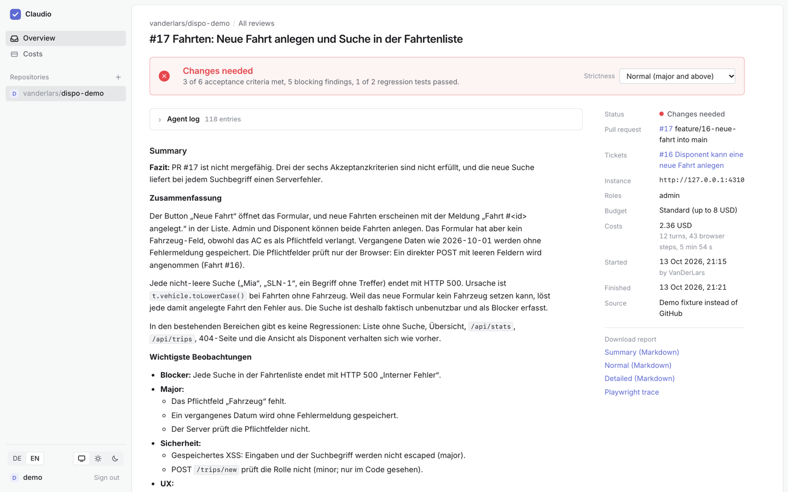
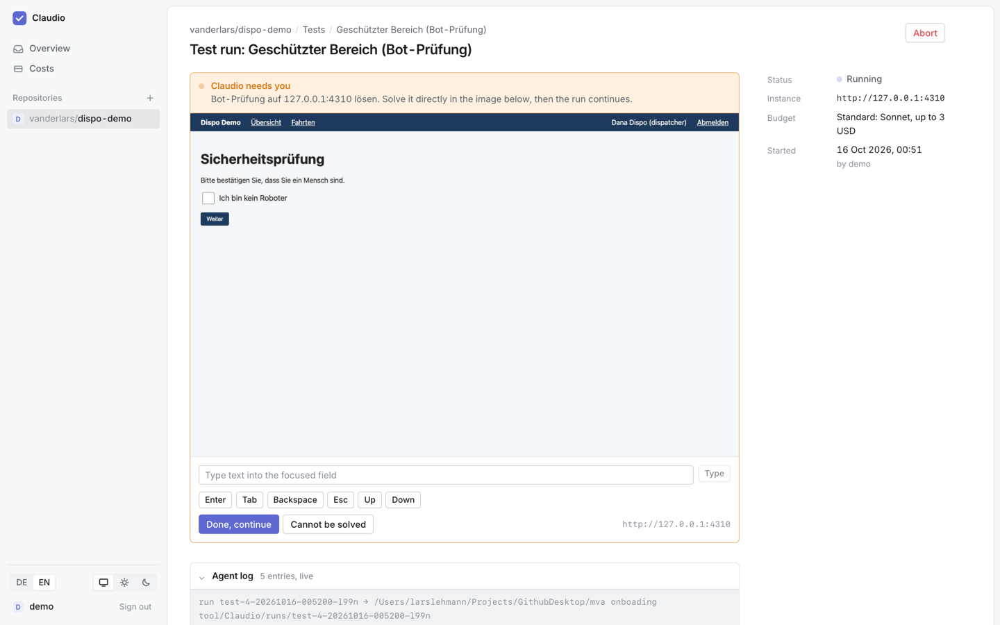
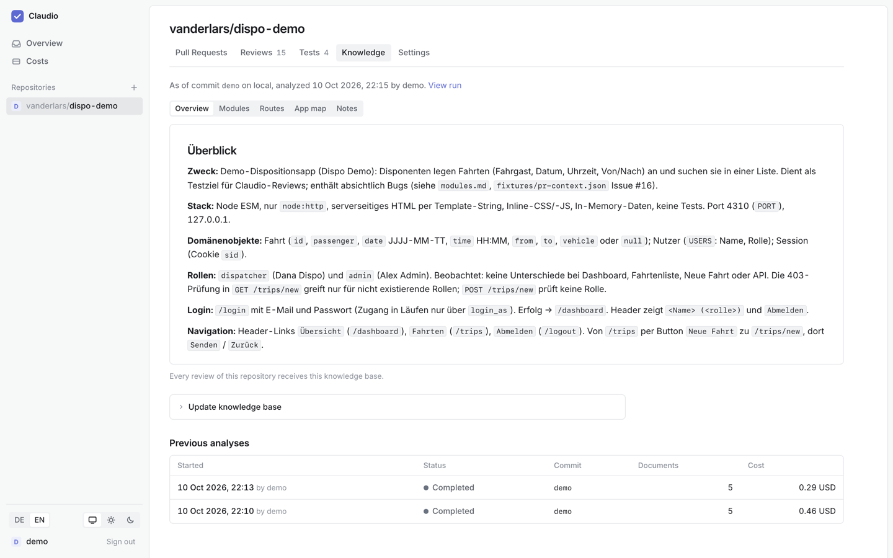
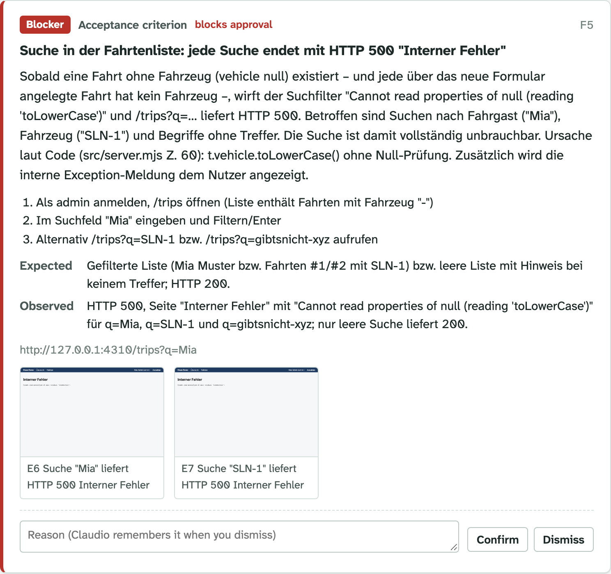
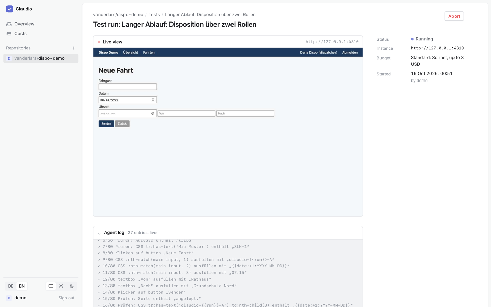

# Claudio

**An AI reviewer that clicks through your pull requests the way a person would.**

Before a feature branch is merged, someone usually has to open the preview, log in, try the new feature, check that nothing around it broke and write down what they found. Claudio does that part for you.

Claudio reads the pull request and its linked issues and works out what the change should do. It then logs into a running instance of the branch and checks every acceptance criterion in a real browser. It also tests the areas the diff touches for regressions and looks at the screens with a UX eye. At the end it writes a report with screenshots as evidence. You decide which findings are real, and Claudio can post a short summary to the PR.

Claudio works with **GitHub** and **GitLab** (gitlab.com or self-managed), also both in one installation. On GitLab, pull requests are merge requests; everything below applies to them too, and [Using GitLab](#using-gitlab) lists the differences.

Claudio is built on the [Claude Agent SDK](https://docs.claude.com/en/docs/agent-sdk/overview) and [Playwright](https://playwright.dev).



> The web interface is available in English and German (switch in the sidebar). Reports can be written in either language.

## What Claudio can do

- **Review pull requests.** Claudio collects the PR, the linked issues and the diff. It derives acceptance criteria, verifies each one in the browser and hunts for regressions in the affected areas. It reviews the changed screens for UX and UI problems. Every finding comes with a severity, steps to reproduce and screenshots.
- **Learn your app.** A repository analysis reads the code and walks through the running app screen by screen. The result is a knowledge base with modules, routes and the expected behaviour of every screen, and every later review starts from it. Updates only re-check what changed since the last analysis.
- **Run tests written in plain language.** You describe a flow and the expected result in plain language. The first run records the steps; later runs replay them without a model, so they are fast and cost nothing. When the UI changes, Claudio repairs the broken steps and tells you what changed.
- **Run automatically.** Reviews can start from a `/claudio review` comment, from a label, or from every push to a PR. They can also start as soon as the PR's preview environment is deployed. Claudio picks up the preview URL from GitHub Deployments. Results come back as a PR review that requests changes when something blocks, never as a failed check.
- **Re-review after fixes.** When a pull request was reviewed before, Claudio re-checks the earlier findings one by one and tests only what changed since. The report and the PR comment say what was fixed and what is still open.
- **Agree on the criteria first.** Before a review starts, Claudio can propose the acceptance criteria from the ticket. You correct them, and the run tests exactly that list.
- **Tell your team in Slack.** Per repository, an incoming webhook gets short messages: when a run needs a person, review and test results, automatic runs and why one could not start.
- **Check on a phone too.** Reviews and tests can run on the desktop, on an emulated phone, or both. A review that checks both does the desktop first and then the changed screens on the phone.
- **Ask instead of guessing.** When the ticket leaves open what a criterion means, the agent asks in the web UI and in Slack and waits for the answer.
- **Turn findings into issues.** A confirmed finding becomes a GitHub issue with steps, expected and observed behaviour and its screenshots.
- **Stay within budget.** Each repository can have a monthly budget. At 80 % a warning goes out; once it is used up, no new run starts.
- **Act as its own GitHub identity.** With the optional GitHub App, comments, reviews, commit statuses and issues come from Claudio itself instead of a person's token.
- **Get better over time.** When you dismiss a finding with a reason, Claudio remembers it for that repository. Test runs can also save practical tips for themselves, such as which button closes the cookie banner.
- **Ask a human when it should.** Claudio never solves CAPTCHAs or bot checks. When one appears, the run pauses, the live browser view in the UI becomes clickable, and a person solves it.
- **Show what it costs.** Each repository uses its own Anthropic API key. A cost page breaks spending down per repository, month and kind of run.



## How it works

```
GitHub or GitLab (pull/merge requests, issues, deployments, webhooks)
        │
        ▼
┌──────────────┐   jobs in MySQL   ┌──────────────────────────────────────────┐
│   Web UI     │ ────────────────► │  Worker                                  │
│  (SvelteKit) │ ◄──────────────── │  Claude Agent SDK + headless Chromium    │
└──────────────┘  live events,     │  → logs into your preview instance       │
                  reports, images  │  → checks, records evidence, reports     │
                                   └──────────────────────────────────────────┘
```

- **The web UI** handles sign-in with GitHub or GitLab and the repository settings. You start reviews, analyses and tests there, watch them live and rate the findings.
- **The worker** picks up queued jobs and runs the agents. Each agent gets one browser and a small set of Claudio tools: logging in as a role, taking screenshots, recording findings.
- **Credentials never reach the model.** Role passwords, GitHub and GitLab tokens and API keys are encrypted in the database. Role passwords go only to the login tool, which fills in the form itself.
- **Permissions follow GitHub and GitLab.** You see a repository in Claudio only if you can read it there. Starting runs needs write access (GitLab: Developer), and changing settings needs admin access (GitLab: Maintainer). An account sees only the repositories of the provider it signed in with.

The full design is in [docs/ARCHITECTURE.md](docs/ARCHITECTURE.md) (written in German).

## What you need

- Node.js 22 or newer and [pnpm](https://pnpm.io) 10
- Docker, for the local MySQL database (MySQL 5.7 and 8 both work)
- An [Anthropic API key](https://console.anthropic.com) for each repository you want Claudio to review
- A GitHub OAuth App or a GitLab OAuth application (or both), so people can sign in. You can skip them for the offline demo.
- A running instance of the branch you want to review, such as a preview or staging deployment. Use test data only: Claudio clicks, types and creates records there.

## Try it: the offline demo

The repository comes with a small, deliberately buggy dispatch app and a fake pull request. You can see a complete review without a GitHub OAuth App or a deployment of your own.

```sh
pnpm install
pnpm --filter @claudio/browser exec playwright install chromium

cp .env.example .env
# In .env: set CLAUDIO_SECRET_KEY (openssl rand -base64 32) and CLAUDIO_DEV_FIXTURES=1

pnpm db:up          # MySQL in Docker on port 3310
pnpm db:migrate
pnpm demo-target    # the buggy demo app on http://127.0.0.1:4310 (keep it running)
pnpm dev            # web UI on http://localhost:5173 plus the worker
```

Open http://localhost:5173 and choose **Sign in to the demo without GitHub**. Under **Repositories**, press **Create demo repository**. Then start a review of its pull request and watch the agent work through the app.

[apps/demo-target/README.md](apps/demo-target/README.md) lists the bugs a good review should find. The demo is the only place where Claudio may use the Claude login of your own machine instead of a repository key, and only on the dev server.

## Set it up for your own repositories

1. **Install and prepare** as in the demo above, but leave `CLAUDIO_DEV_FIXTURES` unset.

2. **Create a GitHub OAuth App** under GitHub → Settings → Developer settings → OAuth Apps → New OAuth App:
   - Homepage URL: `http://localhost:5173`
   - Authorization callback URL: `http://localhost:5173/auth/github/callback`

   Put the client ID and a client secret into `GITHUB_CLIENT_ID` and `GITHUB_CLIENT_SECRET` in `.env`. Claudio asks for the scopes `repo read:user read:org`.

   **For GitLab**, create an OAuth application under GitLab → User settings → Applications (or in a group or the instance admin area): redirect URI `http://localhost:5173/auth/gitlab/callback`, *Confidential* on, scope `api`. Put its ID and secret into `GITLAB_CLIENT_ID` and `GITLAB_CLIENT_SECRET`, and for a self-managed instance its address into `GITLAB_URL`. GitHub and GitLab can be set up side by side; the sign-in page shows a button for each.

3. **Decide who may sign in.** Without any list, everybody can. Limit it with `CLAUDIO_ALLOWED_GITHUB_ORGS` / `CLAUDIO_ALLOWED_GITHUB_USERS` and `CLAUDIO_ALLOWED_GITLAB_GROUPS` / `CLAUDIO_ALLOWED_GITLAB_USERS` (comma-separated; members of a subgroup count for the group above). If you set lists for one provider only, nobody can sign in with the other, so connecting GitLab does not open Claudio to everyone on gitlab.com.

4. **Start it** with `pnpm dev` and sign in.

All settings are explained in [.env.example](.env.example). Keep `CLAUDIO_SECRET_KEY` safe: it encrypts everything sensitive in the database, and if you change it, stored credentials can no longer be read.

## Using Claudio

### 1. Add a repository

Under **Repositories**, pick one of your repositories on GitHub or GitLab. Then open its **Settings** tab:

- **Anthropic API key.** Every model call for this repository runs on this key, and runs do not start without one. Claudio checks the key when you save it and only ever shows its last characters.
- **Roles.** These are the users Claudio may log in as, for example "admin" or "dispatcher", each with a username, a password and the login page. If your login form is unusual, add a login recipe.
- **Notes for the agent.** Anything a new tester would need to know, such as "dates use DD.MM.YYYY".
- **Test data confirmation.** Confirm that your instances contain test data only. Reviews start only after you do.

### 2. Let Claudio learn your app (recommended)

In the **Knowledge** tab, start an analysis against a running instance of your main branch, such as staging. Claudio reads the code, walks through the app and writes a knowledge base. The tab shows when the knowledge base is behind the branch; updating it only looks at what changed.



### 3. Review a pull request

Pick an open PR and press **Start review**. Enter the address of the PR's running instance; if your PR previews are GitHub Deployments or GitLab environments (review apps), Claudio fills it in for you. Then choose the roles, a budget, how detailed the report should be and how strict the verdict should be.

| Budget | Good for | Cost cap |
|---|---|---|
| quick | small changes, one agent does everything | ~2 USD |
| standard | most PRs; separate agents check criteria, regressions and UX | ~8 USD |
| thorough | large or risky changes | ~25 USD |

While the review runs, you can watch the agent's browser live and cancel at any time. Afterwards, go through the findings and **confirm** or **dismiss** each one. The verdict updates as you rate them. You can post the summary to the PR or download the report as Markdown.



### 4. Write tests

In the **Tests** tab, describe a flow, the expected result and the role, all in plain language. The first run records the steps. Later runs replay them without a model, either on their own, as a suite, or with every PR review as a regression test.



Each test can be marked as deterministic, semi-deterministic or explorative. Deterministic tests replay exactly and cost nothing. Semi-deterministic runs are replayed and then checked by a model against the expected result. Explorative tests run with an agent every time. Tests have their own budgets, from *Quick* (Haiku, up to 1 USD) to *Extra thorough* (Opus with extended thinking, up to 8 USD).

### 5. Automate it

In the repository settings, Claudio can create a webhook on GitHub or GitLab for you. This needs admin rights on the repository (GitLab: Maintainer) and a public address in `PUBLIC_BASE_URL`. You can then turn on any of these triggers:

- a PR comment `/claudio review` (optionally `quick`, `standard` or `thorough`)
- the label `claudio-review`
- every opened or updated pull request
- every successful deployment of a PR to your preview environment: set the environment name, for example `Preview`, and Claudio waits for the deployment and uses its URL
- updating the knowledge base after every push to the default branch

You can also set a URL template such as `https://pr-{pr}.preview.example.com` (the placeholders `{pr}`, `{branch}`, `{branch_slug}` and `{sha}` are available). The commit status **Claudio** turns green once the review is done and names the result in its text. If Claudio finds something blocking, it posts its summary as a review with **Changes requested**. With "Require a pull request before merging" in your branch protection, that request blocks the merge until a later Claudio review withdraws it. Automated runs use the GitHub token of the person who set up the webhook, and they post in that person's language.

To try webhooks locally, expose the dev server through a tunnel (for example `cloudflared`) and set `PUBLIC_BASE_URL` to the tunnel address.

### Using GitLab

Everything above works the same with GitLab. The differences:

- **Repositories** can sit in nested groups; Claudio shows them under `/repos/gitlab/<group>/…/<project>`. Merge requests are referenced as `!12`, issues as `#12`.
- **Linked issues** are the ones the merge request closes, plus `#12` references in its description and the issue number at the start of a branch name (`12-new-trip`, as GitLab names branches created from an issue).
- **Review instances**: set the environment of your review apps, for example `review`. It covers every environment in that folder (`review/12-new-trip`), and automatic reviews start when GitLab reports the deployment as successful.
- **The result** comes as a commit status **Claudio** on the merge request's head commit. With blocking findings, Claudio posts its summary as a review that requests changes; a later review without blocking findings withdraws the request. Requested changes block merging only in GitLab Premium and Ultimate. To keep a merge request from being merged while Claudio is still reviewing, turn on *Pipelines must succeed*.
- **Claudio's own identity**: without a GitHub App equivalent, Claudio writes with the token of a person. To have comments, statuses and issues come from Claudio, create a dedicated GitLab user, invite it as *Developer* to your projects and put a personal access token of it (scope `api`) into `GITLAB_BOT_TOKEN`. The repository settings show the bot's role and when its token expires.

## Command line

You can also run a single review without the web UI. Copy `claudio.config.example.json` to `claudio.config.json` and describe your roles there. Credentials are referenced by environment variable name, so they stay out of the file. Set `ANTHROPIC_API_KEY` and `GITHUB_TOKEN` (for GitLab: `GITLAB_TOKEN`, and `GITLAB_URL` for a self-managed instance) in `.env`. Then run:

```sh
pnpm claudio review \
  --repo your-org/your-app \
  --pr 123 \
  --url https://pr-123.preview.example.com \
  --role editor \
  --budget standard
```

| Option | Values | Default |
|---|---|---|
| `--provider` | `github`, `gitlab` (then `--repo group/…/project` and `--pr` is the merge request's number) | `github` |
| `--budget` | `quick`, `standard`, `thorough` | `standard` |
| `--verbosity` | `tldr`, `normal`, `detailed` | `normal` |
| `--strictness` | `lenient`, `normal`, `strict` | `normal` |
| `--lang` | `de`, `en` | `de` |
| `--comment` | post a summary comment to the PR | off |
| `--headed` | show the browser window | off |
| `--no-clone` | skip checking out the branch for code analysis | clone |

The results land in `runs/<runId>/`. The folder holds the report as Markdown and JSON, the findings, screenshots, console and network logs, a Playwright trace and the full agent transcript. The web app replays the trace as a timeline on the review and test-run pages, with the findings, acceptance criteria, screenshots and the agent's notes marked on it; the worker keeps a compact copy of it in the database for the retention period, so the timeline survives the run directory.

## Running it in production

Build the web UI with `pnpm --filter @claudio/web build`. Then run `node apps/web/build` (with `ORIGIN` and `PORT` set) and `pnpm worker` next to it, against the same database.

This repository also contains the setup we use ourselves: a Docker image, Kubernetes manifests in `k8s/` and a GitHub Actions pipeline that tests, builds and deploys every push to `main`. See [docs/DEPLOYMENT.md](docs/DEPLOYMENT.md). The host names, organisation and namespace in there are ours; replace them with your own.

## Security and privacy

- **Point Claudio at test instances only.** It creates, changes and deletes data the way a tester would.
- **Know what is sent where.** Page content, screenshots and code from the PR go to Anthropic's API as part of a run. Passwords and tokens are not sent.
- **Keep the encryption key safe.** Tokens, role credentials, webhook secrets and API keys are stored encrypted with `CLAUDIO_SECRET_KEY`.
- **Webhooks are verified.** The public endpoints `/webhooks/github` and `/webhooks/gitlab` accept only deliveries that carry the repository's own secret (GitHub signs with it, GitLab sends it as a token).
- **The agent stays on your app.** By default it may only open the instance under review. You can allow more hosts per repository or per test.

## Development

```sh
pnpm typecheck
pnpm test                          # unit tests
CLAUDIO_INTEGRATION=1 pnpm test    # also the browser integration tests (needs Chromium)
```

| Part | What it contains |
|---|---|
| `packages/core` | schemas, budget tiers, report rendering |
| `packages/forge` | GitHub and GitLab: pull/merge requests, issues, deployments, webhooks |
| `packages/browser` | Playwright driver, login, evidence capture, Claudio tools |
| `packages/agent` | Agent SDK runners and prompts for reviews, analyses and tests |
| `packages/db` | Drizzle schema, migrations, queries, encryption |
| `apps/web` | the SvelteKit web UI |
| `apps/worker` | the job runner |
| `apps/cli` | the command line |
| `apps/demo-target` | the buggy demo app |

The agent and skill definitions in `.claude/` are shared by the SDK runs and by Claude Code. After changing `packages/db/src/schema.ts`, run `pnpm db:generate` and commit the new migration.

Bug reports and pull requests are welcome.
